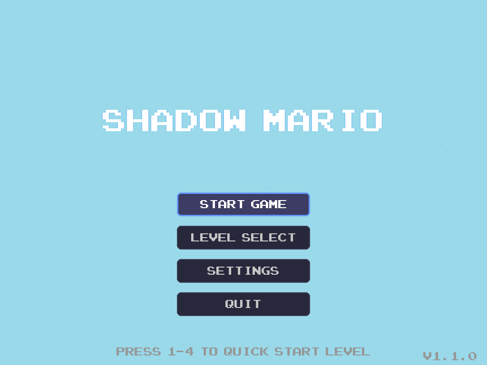
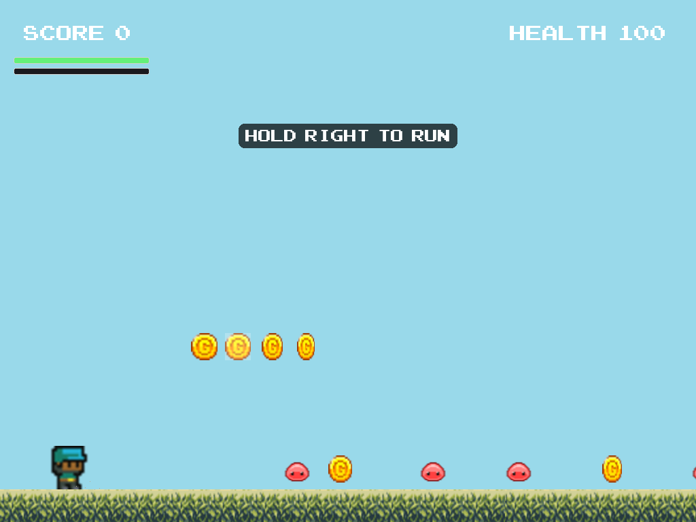
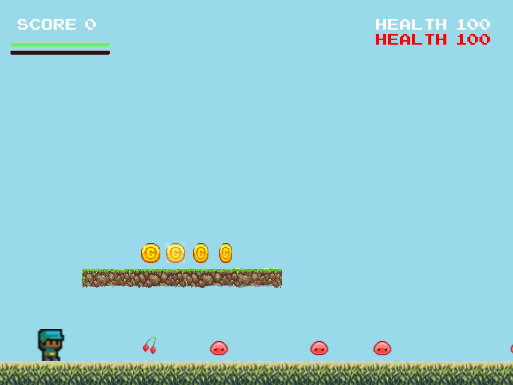
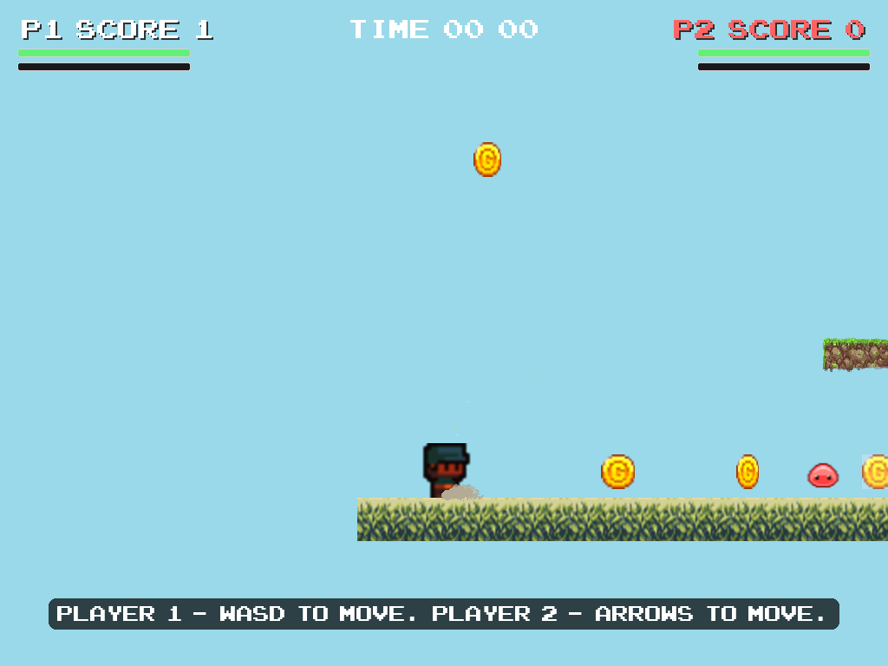

# Shadow Mario（Python + Pygame）

Shadow Mario 是一个基于 Python + Pygame 的 2D 平台游戏项目。  
当前项目包含 4 个关卡、完整场景系统（菜单/加载/游戏/暂停/设置/结算）、音频与存档系统，以及粒子/震屏/过渡等效果模块。

**在浏览器里直接玩：[frank-owl.itch.io/shadowmario](https://frank-owl.itch.io/shadowmario)**

## 游戏截图

| 主菜单 | 第 1 关 |
| --- | --- |
|  |  |

| 第 3 关（Boss 战） | 第 4 关（双人竞速） |
| --- | --- |
|  |  |

## 功能概览

- 四个可游玩关卡
- 第 2/3 关平台行为对齐经典实现逻辑
- 第 4 关为双人竞速模式（P1 vs P2）
- 第 1-3 关跳跃更宽容：跳跃缓冲、土狼时间、可变跳跃高度（轻点小跳，按住满跳）
- 打击反馈：命中停顿、挤压拉伸、受伤闪红
- 第 1 关在关卡内教操作，提示会根据玩家的动作出现和消失
- 任何帧率下都固定每秒 60 tick；每次尝试都能保存并精确回放
- 运行时配置支持（`res/runtime_config.json`）
- 存档支持关卡解锁、最高分、最佳时间、金币、成就与音量设置；桌面版存在系统的用户数据目录，浏览器版存在 `localStorage`

## 玩法规则

- 第 1 关：教学风格的单人关卡
- 第 2 关：单层移动平台关卡
- 第 3 关：双层平台 + Boss 战关卡
- 第 4 关：双人竞速，按得分判定胜负
- 终点旗：角色在水平方向与旗杆齐平或越过旗杆即算到达，空中、地面都算（第 3 关还需先击败 Boss）
- 终点规则：在关卡数据中，终点旗帜右侧不再生成实体

## 环境要求

- Python 3.10+
- pip
- 可用的桌面图形环境（Pygame/SDL）

## 快速运行

```bash
python3 -m venv .venv
source .venv/bin/activate
pip install -r requirements.txt
python3 main.py
```

也可以使用：

```bash
./run.sh
```

## 操作说明

### 菜单/全局

- `Up` / `Down`：菜单选择
- `Enter` / `Space`：确认
- `1` / `2` / `3` / `4`：菜单快速进关
- `Esc`：返回/暂停/退出（视场景而定）
- `F12`：截图到 `screenshots/`
- `F9`（关卡内）：把本次尝试的输入存到 `replays/`（见下方“试玩”）

### 第 1-3 关（单人）

- `Left` / `Right`：移动
- `Up`：跳跃
- `S`：Boss 进入激活范围后可发射，火球方向跟随角色朝向（左/右）

### 第 4 关（双人）

- `P1`：`W` / `A` / `D`
- `P2`：`Up` / `Left` / `Right`

## 项目结构

```text
ShadowMarioPython/
├── main.py                    # 脚本入口
├── run.sh
├── requirements.txt
├── requirements-dev.txt
├── Makefile
├── res/                       # 资源与配置
├── shadow_mario/
│   ├── app.py                 # 统一运行入口
│   ├── app_context.py         # 共享上下文依赖
│   ├── scene_payloads.py      # 场景跳转数据模型
│   ├── level.py               # 关卡主编排
│   ├── level_components.py    # 关卡协作组件
│   ├── storage.py             # 存档位置：用户数据目录或 localStorage
│   ├── simulation.py          # 固定步长时钟、输入录制与回放
│   ├── input.py               # 可录制的逐 tick 按键状态
│   ├── telemetry.py           # 本地试玩事件日志
│   ├── scenes/
│   └── entities/
├── tools/
│   ├── build_web.sh           # 从干净副本构建浏览器版（pygbag）
│   ├── web_smoke.py           # 在无头 Chromium 中启动构建产物和 itch.io 的 zip
│   ├── make_replays.py        # 重新生成 tests/replays/
│   ├── replay.py              # 重看保存的尝试
│   └── playtest_report.py     # 遥测汇总与各关热力图
├── docs/                      # FEEL_AUDIT、PLAYTEST、ASSETS、截图
├── tests/                     # 含 tests/replays/ 参考回放
└── .github/workflows/
    ├── ci.yml                 # 3.10/3.12 检查，web 构建与浏览器启动
    └── deploy-itch.yml        # 手动部署到 itch.io
```

## 开发与检查

安装开发依赖：

```bash
pip install -r requirements-dev.txt
```

执行统一检查：

```bash
make check
```

### 固定步长与回放

关卡固定以每秒 60 tick 运行，与显示帧率无关；所有随机数来自每关的种子，所以同一段录制输入总能回放出同样的结果。`tests/replays/level1-4.json` 是参考通关录像，CI 会在 30/60/144fps 下回放。若有意改动了关卡玩法，用下面的命令重新生成，并在提交说明里写明原因：

```bash
python tools/make_replays.py
```

### Web 构建

```bash
pip install pygbag==0.9.3 playwright && python -m playwright install chromium-headless-shell
tools/build_web.sh          # 从干净副本构建 build/web/ 与 build/web.zip
python tools/web_smoke.py   # 在无头 Chromium 中启动 build/web 和发给 itch 的 zip，出现 Python 报错即失败
```

CI 每次推送都会跑这两步并保留 `web.zip`。发布到 itch.io 需手动触发 `Deploy web build to itch.io` 工作流。

### 试玩

桌面版会把受伤、死亡、关卡结果记录到本地 `telemetry/events.jsonl`（不上传，`SHADOW_MARIO_TELEMETRY=0` 可关闭）。试玩后：

```bash
python tools/playtest_report.py             # 汇总表 + 各关热力图，输出到 telemetry/report/
python tools/replay.py replays/<file>.json  # 重看用 F9 保存的尝试
```

试玩脚本与记录表见 [docs/PLAYTEST.md](docs/PLAYTEST.md)；测量与改动记录见 [docs/FEEL_AUDIT.md](docs/FEEL_AUDIT.md)；素材来源见 [docs/ASSETS.md](docs/ASSETS.md)。

## 常见问题

- 无法初始化图形窗口：确认本机图形环境可用。
- 没有声音：检查系统音频设备、游戏内静音和音量配置。
- 存档位置：macOS `~/Library/Application Support/ShadowMario/save.json`，Windows `%APPDATA%\ShadowMario\save.json`，Linux `~/.local/share/shadow-mario/save.json`；设置 `SHADOW_MARIO_DATA_DIR` 可改到别的目录。浏览器版在 `localStorage`（键名 `shadowmario/save.json`）。2026 年 10 月之前放在项目目录里的 `save.json` 会在首次运行时复制过去，原文件保留。
- 存档损坏：游戏会把读不了的存档改名为 `save.json.corrupt` 后从头开始，不会覆盖它；想重置就删掉存档。

## 其他文档

- 英文主文档：[README.md](README.md)

## 许可证

MIT，详见 [LICENSE](LICENSE)。
